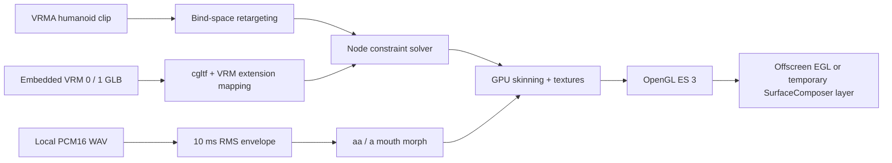

# Native VRM experiment (Athena)

Related: [EchoLocal #34](https://github.com/rainu/echolocal/issues/34),
[original browser-path study](https://github.com/rainu/echolocal/pull/35).

The owner explicitly extended the earlier study to try a **native VRM engine**.
This is that isolated proof of concept, not a production Talk/avatar feature.
It does not change EchoLocal's executable, settings, Cast process or Talk flow.

## Architecture



No Android Activity, package manager, WebView, Java, Chromium or network server
is needed. A separate native executable uses the Android GLES driver directly.
The optional display adapter uses the same vendor-specific API-28 ABI approach
as libcountertop. This adapter is **not** a portable Android public API.

## Implemented subset

| Area | Implemented | Not implemented / not established |
| --- | --- | --- |
| Assets | Embedded binary glTF with VRM 0 or VRMC_vrm 1 extension; selected scene; PNG/JPEG | OCA ZIP import, external/data URI resources, Draco, meshopt, KTX2 |
| Geometry | Indexed triangle meshes, UVs, depth, 4-weight GPU skinning, up to 192 joints/skin | Eight-weight vertices, arbitrary glTF primitive modes, full untrusted-asset hardening |
| Materials | Base-color textures/factors, simple lighting/unlit, alpha mask/blend | Full MToon, outlines, normal maps, UV animation, material-expression binds; transparent parts are not depth-sorted |
| Animation | Humanoid head/neck/chest motion and arm rest pose; external VRMA rotation and hips-translation tracks; LINEAR / STEP / CUBICSPLINE | Arbitrary clip conformance, expression/lookAt VRMA tracks, IK, motion transitions; nonuniform-scale/matrix-only animated rigs |
| VRM constraints | Dependency-ordered rotation, roll and aim constraints | Full VRM conformance suite, spring bones/colliders, lookAt behavior |
| Expressions | VRM0 mesh/index and VRM1 node/index morph binds; blink and aa/a | isBinary/override rules, material/UV binds, full expression mixer |
| Mouth | Fixed scalar, explicit synthetic demo or local PCM16 WAV RMS envelope | Phoneme/viseme recognition, real speaker-queue alignment, live Talk playout |
| Lifecycle | Bounded duration, SIGINT/SIGTERM exit, separate owned layer, GL/model cleanup | Daemon-owned production supervision and crash/reconnect lifecycle |

Resource guards reject files above 64 MiB, external buffers/images, more than
500k uploaded vertices, more than 192 joints/skin, textures above 4096 pixels
per dimension, more than 128 MiB base RGBA texture bytes and 192 MiB expanded
morph data. These are prototype rejection limits, **not measured device budgets**.
Texture accounting excludes mipmaps and driver allocation. Only trusted,
license-reviewed test files have been exercised; this is not a secure asset
ingestion service.

## Reproduce

Read [license/asset terms](THIRD_PARTY.md). This directory is AGPL-3.0-only
because its surface bridge derives from libcountertop. Vendored dependencies
retain their MIT notices. No third-party avatar or motion asset is in Git.

Use an existing NDK and the authorized build environment; do not install tools
on the Echo or change its framework/browser configuration.

```sh
NDK_BIN=/path/to/existing/ndk/toolchains/llvm/prebuilt/your-host/bin \
  sh experiments/native-vrm/build.sh

python3 experiments/native-vrm/download-samples.py /private/artifacts/native-vrm
python3 experiments/native-vrm/make-fixtures.py /private/artifacts/native-vrm/fixtures
```

Set `ADB` to the authorized ADB wrapper and `SERIAL` to the target, locally.
Use a new private temporary device directory. Check free space first; preserve
the installed daemon and existing rollbacks. Example names below are generic.

```sh
"$ADB" -s "$SERIAL" shell df -k /data
"$ADB" -s "$SERIAL" shell 'mkdir /data/local/tmp/native-vrm-test && chmod 700 /data/local/tmp/native-vrm-test'
"$ADB" -s "$SERIAL" push experiments/native-vrm/out/native-vrm-arm /data/local/tmp/native-vrm-test/viewer
"$ADB" -s "$SERIAL" push /private/artifacts/native-vrm/Seed-san.vrm /data/local/tmp/native-vrm-test/model.vrm
"$ADB" -s "$SERIAL" shell 'chmod 700 /data/local/tmp/native-vrm-test/viewer'
"$ADB" -s "$SERIAL" shell '/data/local/tmp/native-vrm-test/viewer --self-test'
"$ADB" -s "$SERIAL" shell '/data/local/tmp/native-vrm-test/viewer /data/local/tmp/native-vrm-test/model.vrm --seconds 5 --out /data/local/tmp/native-vrm-test/frame.ppm'
```

Verify host/device executable and asset SHA256 before accepting results. Pull
the PPM and visually inspect it: a successful EGL call is not rendering proof.
After that, `--display --seconds 30` creates a 640x640 layer at `(640,80)` on
the 1280x800 Athena display. Capture the **composed display** through the normal
screen tool during the run. On exit the layer disappears and reveals the
unmodified underlying clock/UI; do not restart the daemon to remove a test.

### Animation, expressions and audio envelope

Push the generated fixture directory and choose `--animation .../linear.vrma`,
`step.vrma` or `cubicspline.vrma`. The generator also emits malformed GLB/WAV and external-URI rejection fixtures.
The viewer must reject those with a nonzero exit and must not fetch the external
resource. Invalid duration and non-finite mouth values are rejected before
opening EGL. These newly authored clips exercise head
rotation and hips translation on a two-second loop. Retargeting to both VRM
generations is experimental, not general motion-library compatibility proof.

`--static --mouth 0` and `--static --mouth 1` produce directly comparable images
for neutral and open-mouth tests. `--wav .../reference-envelope.wav` drives the
mouth using a 10 ms RMS envelope. It **does not play the WAV**, start Talk,
record a microphone or test acoustic synchronization. The generated tone has
known silent/voiced intervals and contains no voice. `--demo-mouth` explicitly
uses a sinusoid; the ordinary idle mouth is closed. Blinking is periodic.

### Metrics and a sustained run

`--seconds 900 --display --demo-mouth --animation .../linear.vrma` gives a
15-minute on-screen test. Maximum accepted duration is 1200 seconds. Record
the final process exit status, not just its launch or initial output.

- `LOAD_MS`: parsing, upload, shader compilation, clip/envelope preparation.
- `FIRST_FRAME_MS`: first completed GPU frame since process initialization.
- `WORK_MS_*`: update/draw plus `glFinish`; **excludes swap and pacing**.
- `INTERVAL_MS_*`: actual render-loop start intervals, including swap/pacing
  and screenshot overhead; not measured physical display presentation times.
- `FPS`: completed render loops / elapsed time, deliberately capped at 30.
- `CPU_CORES_AVERAGE`: process user+system CPU / loop wall time, not GPU load.
- `PEAK_RSS_KIB`: process high-water RSS, including startup; not incremental
  system/driver memory. Sample `/proc/<owned pid>/smaps_rollup` separately for
  PSS and read-only thermal/frequency telemetry if available.

After a run, retain hashes, source, logs and permitted screenshots privately.
Remove only this experiment's known temporary files after pulling/verifying
them. Check that its processes/layer are gone and normal screen/service/Talk
state remains. Do not remove another worker's files, stop a human conversation
or change the Cast receiver.

## Future Talk integration outline (not implemented here)

At source `a50e5677`, the integration points are:

1. `internal/feature/clawtalk/manager.go`: tie one viewer to `Manager.generation`
   and its existing activation context. Cancel/end/error/mute may stop only
   that generation's viewer. Never create an additional Talk connection.
2. `internal/feature/clawtalk/audio.go`, `deviceAudio.playoutPump`: analyze the
   PCM returned from `a.playout.Take(lane.Queued())` at the existing voice-lane
   submission. `Play` is the **network decode/enqueue** point, not audible
   playout, and therefore is not the correct synchronization clock.
3. A bounded nonblocking latest-value observer must account for
   `lane.Queued()`/output latency and actual voice mute/gain. No raw microphone,
   transcript, credential or PCM payload needs to reach the renderer; only
   generation-owned amplitude/state data. A stalled renderer must never stall
   audio or hold `playMu` across IPC.
4. `deviceAudio.StopOutput` resets the buffer and drains the voice lane:
   interruption/cancel must clear any scheduled mouth values immediately.
   End-of-output follows the actual drain, not the provider's last packet.
5. Listening/thinking/speaking/ended/muted state comes from the existing
   controller; supervised renderer failure returns to the previous native UI.
   Require start/end races, reconnect, load failure, mute, interruption and
   speaker-underrun comparisons before production integration.

See [measured results](RESULTS.md) for the exact evidence and remaining gates.
